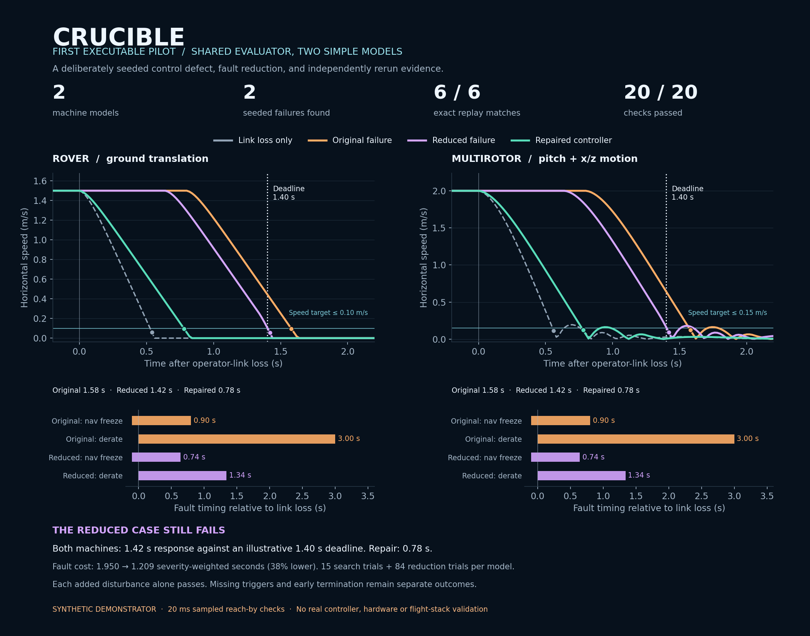

# CRUCIBLE — executable pilot v0.1



**[Download the complete runnable pilot and saved evidence](CRUCIBLE-Pilot-v0.1.zip).** The archive includes the full recorded `results/` tree used by saved-file replay commands. The individual Python files here are also directly inspectable. To regenerate the evidence from these files, run `python validate_pilot.py`.

Prepared for Ray Peloquin. Start with **CRUCIBLE-Pilot-v0.1.png** for the recorded results.

This is a working, local demonstration of the proposed test workflow: one evaluation core, two different simplified motion models, bounded fault search, failure reduction, and replay evidence. The controllers contain a deliberately seeded defect. The model parameters and policies are illustrative settings chosen while constructing this demonstration. This is not a blinded discovery experiment or an externally specified benchmark.

## What actually ran

The same simulation loop, monitor, search, reduction and replay functions run both machine adapters. The rover has longitudinal acceleration lag and ground motion. The multirotor has pitch lag, thrust, gravity, horizontal drag and x/z motion, including a simple altitude controller. Neither model is a validated digital twin.

The seeded defect is easy to state: **the controller processes the independent operator-link signal only when a fresh navigation sample arrives**. A navigation freeze therefore delays the stop/hover response. The repaired controller processes link status independently of navigation freshness. All evidence monitors read privileged simulation truth, not the stale inputs delivered to the controller.

| Recorded case | Rover response | Multirotor response | Reach-by verdict |
| --- | ---: | ---: | --- |
| Operator-link loss only | 0.54 s | 0.56 s | Satisfied |
| Navigation freeze added alone | 1.34 s | 1.36 s | Satisfied |
| Braking derate added alone | 0.78 s | 0.78 s | Satisfied |
| Both added disturbances, original case | 1.58 s | 1.58 s | Violated |
| Both disturbances, reduced case | 1.42 s | 1.42 s | Violated |
| Repaired controller, same reduced schedule | 0.78 s | 0.78 s | Satisfied |

Both illustrative deadlines are **1.40 s**. The rover target is speed ≤0.10 m/s. The multirotor target is horizontal speed ≤0.15 m/s together with altitude error ≤0.25 m. Independent speed and altitude envelopes are also monitored; every observed violation is retained independently of deadline completeness.

The coincident response times in several rows are the outputs of these particular models, parameters and 20 ms sampling grid. They do not establish equivalent physical behavior across machines.

## Fault search and reduction

- One fixed operator-link loss starts at 2.00 s and lasts 4.00 s. It is retained during reduction.
- Fifteen seeded, shuffled candidates vary navigation-freeze duration and braking authority. The search chooses the lowest defined deadline slack among valid, exercised, conclusive trials.
- Every attempted simulation consumes budget. Invalid, unexercised or inconclusive target trials do not become passing search results. A confirmed violation without a defined search objective is still recorded.
- Reduction tries deleting disturbances, shortening their durations, and weakening the derate. An accepted change must preserve the target violation and strictly lower the declared cost.
- Each model used 84 reduction attempts, within a 160-attempt budget. The original and reduced schedules and every accepted/rejected attempt are saved.

| Added disturbance | Original interval | Reduced interval |
| --- | --- | --- |
| Navigation freeze | 1.90–2.80 s | 1.90–2.64 s |
| Braking authority multiplier 0.65 | 2.00–5.00 s | 2.00–3.34 s |

Fault intervals include their start and exclude their end. Cost is additional fault duration multiplied by severity: navigation severity = 1; braking-derate severity = 1 − authority. The fixed trigger is excluded. Thus cost decreased from **1.950 to 1.209 severity-weighted seconds, or 38%**, while the sampled deadline violation remained. This is a local, bounded reduction under the tested moves; no globally smallest witness is claimed. The 38% is not a speedup, reliability improvement or physical-risk estimate.

## Evidence and replay

Each saved case includes model/adapter identifiers, model parameters, controller variant, policy values, fault schedule, tick timing, unmodified numerical traces, delivered navigation timestamps, commands, per-rule outcomes, source SHA-256, Python version, host platform and trace SHA-256. `results/summary.json` summarizes both campaigns. The full per-model search, reduction and replay records are retained alongside case files.

The selected reduced case was rerun from fresh model, adapter and controller instances three times per model. **All 6 replay traces exactly matched their reference canonical JSON hashes in the recorded environment.** Dynamics are deterministic; the seed orders the search candidates. This is local repeatability evidence, not a statistical reliability estimate or a cross-platform reproducibility guarantee.

The replay command rejects a changed saved trace, a verdict inconsistent with its trace and policy, a changed case digest, or different engine source. SHA-256 checks detect changes relative to the stored hashes; the files are not digitally signed and hashes do not establish authorship or authenticity. The serialized configuration and complete trace are necessary evidence, not a promise that arbitrary future software versions will reproduce it.

## Run it

Python 3.10 or newer; the engine and tests use only the standard library. No network, credentials, robot connection or GPU is used. From the extracted folder:

```sh
python crucible_pilot.py run --out fresh-results
python -m unittest -v
python crucible_pilot.py replay results/rover/reduced.json
python crucible_pilot.py replay results/multirotor/reduced.json
```

On Windows, `py -3` can replace `python` when the Python launcher is installed.

The supplied PNG is already rendered. Regenerating it additionally requires Matplotlib:

```sh
python render_report.py --results results --output CRUCIBLE-Pilot-v0.1.png
```

## Scope and remaining work

This checks the workflow on a deliberately constructed, deterministic example. It contains no real flight controller, Gazebo, PX4, ROS, hardware-in-the-loop connection, perception model, collision geometry, wind, terrain, roll/yaw dynamics, communications stack or calibrated actuator model. Its model-specific derate hook scales rover braking acceleration or opposing pitch demand; it does not model a specific motor or mechanical failure.

The stop/hover policies are examples selected for this pilot, not universal safe actions. The deadline predicate asks whether the target was reached by the inclusive deadline; it does not require remaining there. It covers only recorded samples at 20 ms intervals. It does not establish behavior between samples, sustained hovering, general mission continuity, system safety, throughput advantage or commercial novelty. A 20 ms miss in this synthetic model has no established physical significance.

The next engineering gate is an independently specified scenario and a real simulator/controller integration, followed by adapter contract tests, fidelity assessment and replay/divergence checks under a pinned environment. Related existing work includes [VerifAI](https://github.com/BerkeleyLearnVerify/VerifAI) and [Scenic's replay facilities](https://docs.scenic-lang.org/en/3.x/api.html). This pilot is an implementation of CRUCIBLE's proposed evidence workflow, not a claim to have invented simulation-based falsification.

## Files

- `crucible_pilot.py`: shared evaluator, models/adapters, controllers, search, reducer, case export and replay CLI.
- `test_pilot.py`: 20 checks covering monitor edge cases, coverage, budget accounting, independent violations, adapter compatibility, stale navigation timestamps, altered evidence and both complete workflows.
- `validate_pilot.py`: runs the tests, campaign and saved-file replay commands and writes the validation record.
- `render_report.py`: optional renderer of recorded result data.
- `results/`: full case traces, search attempts, reduction attempts, replay hashes and summary.
- `VALIDATION.json`: checks completed during preparation.
- `CRUCIBLE-Pilot-v0.1.png`: recorded results overview.
