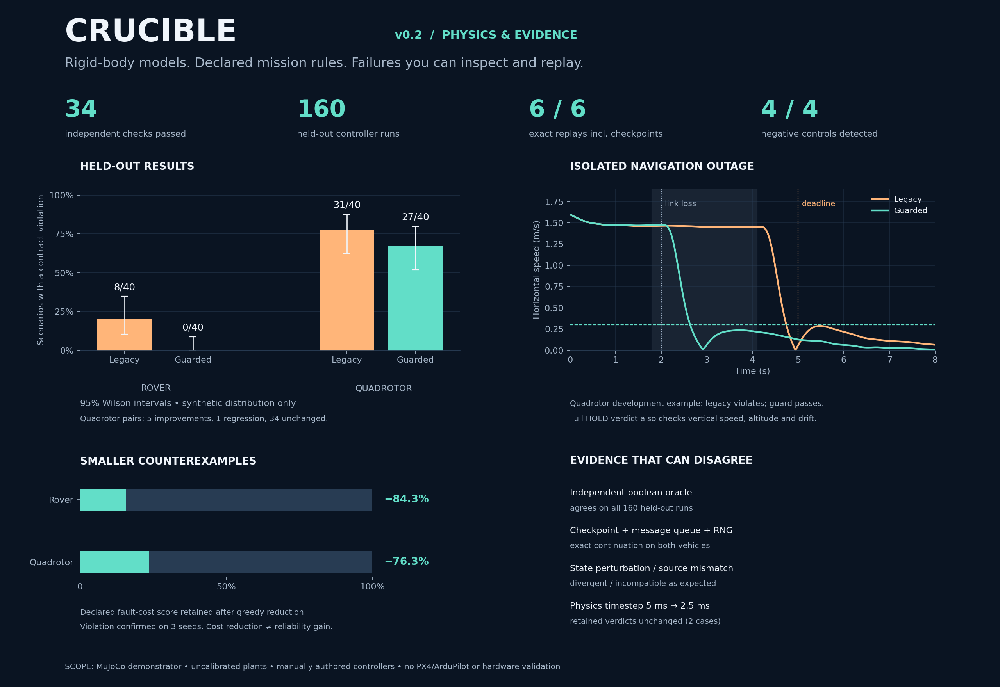

# CRUCIBLE — autonomy testing demonstrator

**Latest: v0.2, physics and evidence.** MuJoCo rigid-body models, a differential-drive rover with wheel contact, a free six-DOF quadrotor, noisy delayed sensors, wind, actuator limits, mission contracts and replay controls.



**[Download v0.2: runnable source, all recorded traces and offline explorer](CRUCIBLE-v0.2.zip)** · [Inspect v0.2 source and methods](v0.2/README.md) · [Download the standalone evidence explorer](CRUCIBLE-v0.2-Explorer.html)

Download the HTML and open it locally; GitHub displays its source rather than running it. The archive contains all 160 held-out traces and the source/environment freeze. `v0.2/` provides directly inspectable source and summary records; extract the archive for complete saved-file replay inputs.

| Held-out contract violations | Legacy controller | Guarded controller |
| --- | ---: | ---: |
| Rover | 8/40 | 0/40 |
| Quadrotor | 31/40 | 27/40 |

34 checks passed; all 160 held-out evaluations agreed with the independent Boolean oracle. Six saved-file/checkpoint replay checks matched exactly, and four deliberate state/source changes were detected. Quadrotor pairs include five improvements **and one regression**. The guarded quadrotor still fails 27 cases. Zero rover violations in 40 cases does not establish zero risk; its 95% Wilson upper bound is 8.8% under the declared synthetic distribution.

**Scope:** uncalibrated simulation demonstrators and manually authored controllers, including a deliberately defective legacy baseline. No production autopilot, hardware validity, automatic defect diagnosis/repair, flight readiness, or field reliability is established. The independent oracle and exact replay can share modeling/specification mistakes. See the [full methods and limitations](v0.2/README.md).

## Run v0.2

Extract `CRUCIBLE-v0.2.zip`, enter the extracted folder, and use Python 3.12:

```bash
python3.12 -m venv .venv
source .venv/bin/activate
python -m pip install -r requirements.txt
python -m crucible validate
python -m crucible replay results/rover/reduced.json.gz
python -m crucible campaign --output results-new
```

Exact replay is checked only for the recorded source, contract and environment. A fresh campaign refuses to overwrite an existing freeze. Mission thresholds and fault ranges are configurable in `contracts/mission.json`; only implemented STOP/HOLD policy bindings are supported.

## Earlier release

[v0.1 source/methods](v0.1/README.md) · [Complete v0.1 archive](CRUCIBLE-Pilot-v0.1.zip) · [v0.1 overview](CRUCIBLE-Pilot-v0.1.png).

The original v0.1 Python files and validation record remain at the repository root. They are the earlier standard-library workflow pilot, not the MuJoCo v0.2 implementation. Its original claims and evidence are preserved for comparison.
